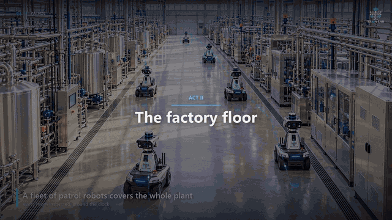
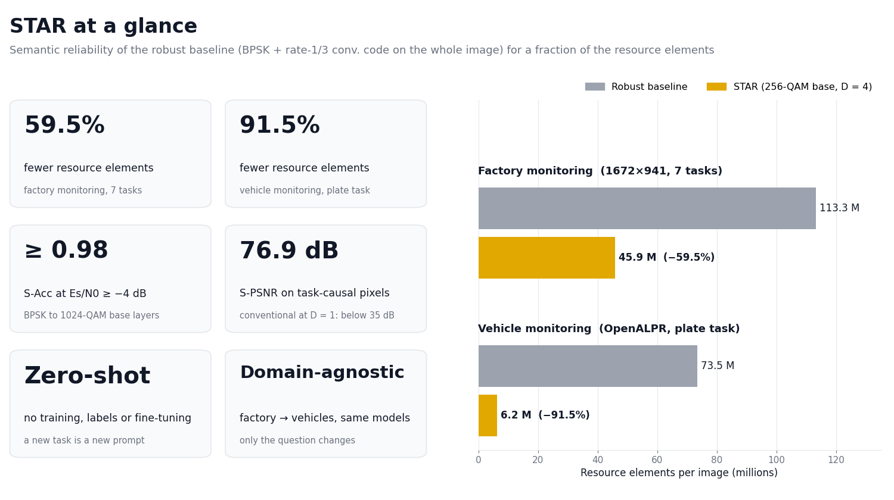
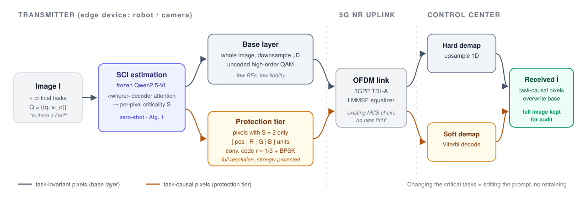
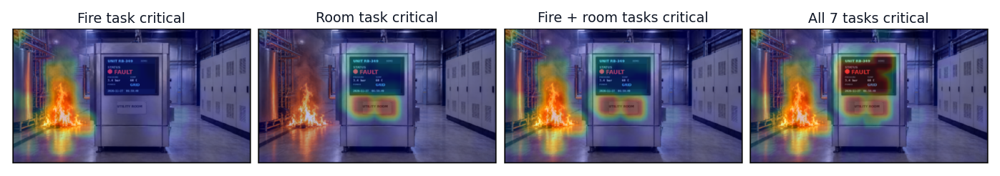
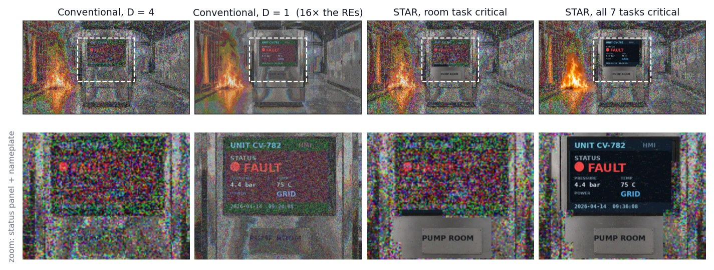
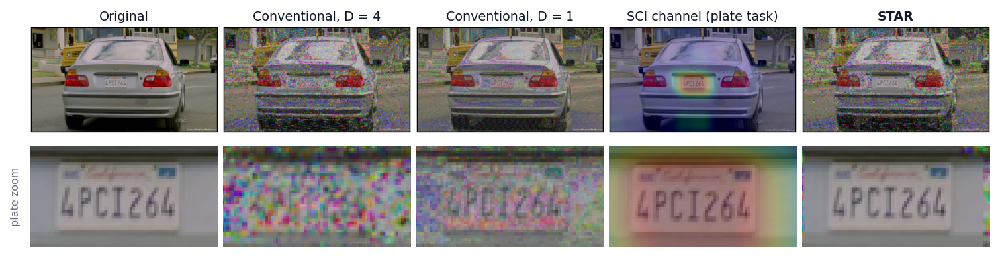
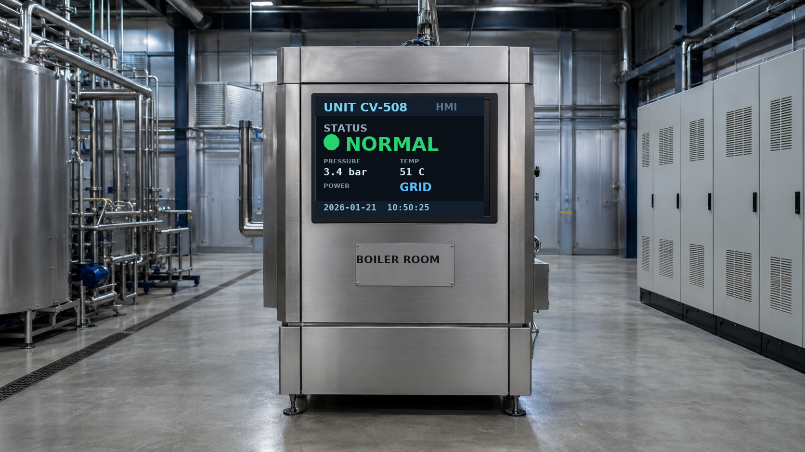
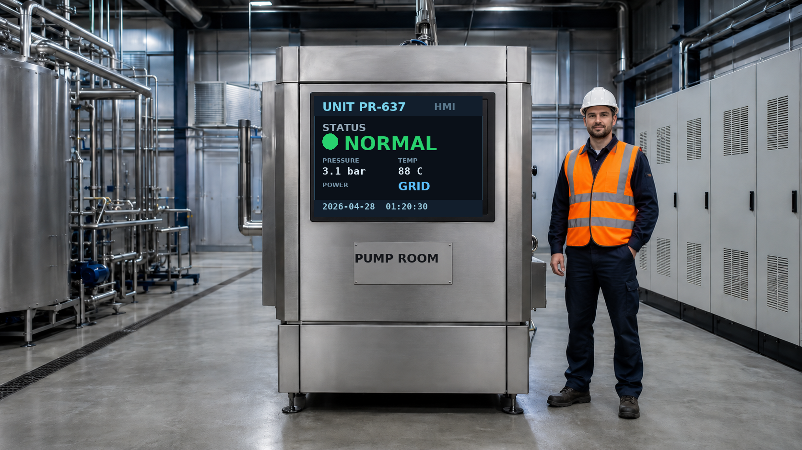
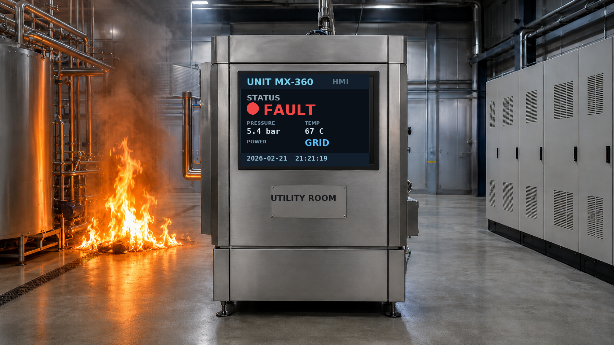

<div align="center">

# STAR


### Semantic-Criticality Tiered Allocation of Radio Resources via Zero-Shot Learning

**Albert Shaju · Christo Kurisummoottil Thomas**<br>
Worcester Polytechnic Institute

[](https://www.python.org/)
[](https://pytorch.org/)
[](https://nvlabs.github.io/sionna/)
[](https://huggingface.co/docs/transformers)
[](https://huggingface.co/Qwen/Qwen2.5-VL-7B-Instruct)
[](https://ollama.com/)
[](https://jupyter.org/)
[](#how-star-works)
[](#how-star-works)
[](deepjscc_baselines/)

</div>

---

**Send the whole image, but protect only what the task needs.** In remote inference, the answer to a task
often depends on a small set of *task-causal* pixels, such as those of text. STAR derives a per-pixel
*semantic-criticality indicator* (SCI) from the attention of a frozen vision-language model and spends strong
channel protection only on those pixels. A cheap, downsampled base layer still carries the whole image for
audits. New tasks and domains need only a new question: no training, no labels, no fine-tuning, and no
changes to the 5G NR physical layer.

<p align="center">
  <a href="assets/STAR_teaser.mp4"></a>
  <br><b>▶ <a href="assets/STAR_teaser.mp4">Watch the 1-minute teaser</a></b> (1080p) &nbsp;·&nbsp;
  <a href="../../releases/tag/video-v1">Full 2:14 explainer (1080p download)</a>
</p>

<p align="center">
  
</p>

## How STAR works

<p align="center">
  
</p>

1. **Task causality-aware resource allocation.** STAR minimizes the REs per image subject to a semantic
   distortion bound for every task. The exact solution is a threshold rule on the criticality-weighted causal
   influence of each pixel (Proposition 1), which is computed once per image, while only the thresholds
   follow the channel.
2. **SCI estimation via zero-shot learning (Algorithm 1).** A frozen Qwen2.5-VL-7B answers each task query
   and is asked *where* its evidence is. The decoder attention of those location tokens estimates the causal
   influence of each pixel, giving the SCI. The operator marks tasks as critical in the prompt.
3. **Tiered transmission.** A *base layer* carries the whole image, downsampled by D = 4 and sent uncoded with
   256-QAM. A *protection tier* carries the self-addressed task-causal pixels at full resolution with a
   terminated rate-1/3 convolutional code (κ = 7) and BPSK. At the receiver the decoded pixels overwrite the
   base layer, so the full image is still available for audits. Each tier is an existing MCS carried as a
   separate transport block, so no new physical-layer operation is needed.

### The SCI channel follows the task

Fire-event image, continuous SCI map for four different sets of critical tasks (Fig. 2):

<p align="center"></p>

### What the control center receives

**Factory monitoring**, 256-QAM, E<sub>s</sub>/N<sub>0</sub> = 2 dB (Fig. 3). Sending the raw image at D = 1 costs 16× the
resource elements of D = 4 and still corrupts the text. STAR keeps the D = 4 base layer and delivers exactly
the regions its critical tasks rely on:

<p align="center"></p>

**Vehicle monitoring**, real OpenALPR photographs, 256-QAM, E<sub>s</sub>/N<sub>0</sub> = 10 dB (Fig. 7). The same models and
physical layer, only the query changes to *"What is the license plate number of the vehicle?"*:

<p align="center"></p>

## Results

All results use a Sionna 5G NR OFDM link: 30 kHz subcarrier spacing, 14 OFDM symbols × 128 subcarriers
(1792 data REs per slot), 3.5 GHz, 3GPP TDL-A with 100 ns delay spread, perfect CSI and LMMSE equalization.
Semantic accuracy (S-Acc) is judged by Qwen3-8B on the answers of Qwen3-VL-30B-A3B at the control center, and
S-PSNR is the PSNR over the ground-truth task-causal region.

**Factory monitoring** (60 test images, 7 tasks, all critical):

- STAR attains **S-Acc ≥ 0.98 for E<sub>s</sub>/N<sub>0</sub> ≥ −4 dB** with every base modulation from
  BPSK to 1024-QAM. The conventional scheme never reaches 0.99 at D = 4. At D = 1 it needs 4 dB with
  256-QAM and 16 dB with 1024-QAM.
- STAR's S-PSNR reaches **76.9 dB** at 18 dB with a 256-QAM base layer, while uncoded BPSK and QPSK at
  D = 1 stay below 35 dB.
- The **hybrid DeepJSCC** baseline saturates at S-Acc 0.87 and S-PSNR of about 26 dB. Its classification
  heads answer only the tasks they were trained on.
- With only the room task critical, STAR lifts the room task from 0.02 (D = 4) and 0.68 (D = 1) to
  **1.00**, while the fire task stays at 0.98.

**Vehicle monitoring** (100 OpenALPR photographs, plate task, no change to any model or parameter):

- STAR reaches **S-Acc 0.74 at 4 dB and 0.78 at 12 dB**, against an upper bound of 0.80 on the original
  images. The conventional scheme reaches only 0.53 at 16 dB with D = 1.
- At 16 dB, STAR's S-PSNR is **81.7 dB**, while both conventional schemes remain below 19.5 dB.

**Resource elements per image**, at semantic reliability comparable to the robust baseline (BPSK + rate-1/3
code on the whole raw image):

- Factory monitoring: **113.3 M → 45.9 M REs (−59.5%)**. The hybrid DeepJSCC uses 0.79 M REs, at the cost of
  lower S-Acc and S-PSNR and task-specific training.
- Vehicle monitoring: **73.5 M → 6.2 M REs (−91.5%)**. The saving is larger because the task-causal pixels
  are sparser.

SCI estimation takes 5.3 s per task (eager attention, bfloat16, no batching). It runs once per image, not
once per channel realization.

## DeepJSCC baselines

[`deepjscc_baselines/`](deepjscc_baselines/) contains the trained, task-specific baselines that STAR is
compared with, on the same 5G NR link: a reconstruction DeepJSCC, a task-oriented DeepJSCC and the
semantic-aware (hybrid) DeepJSCC of the paper. It includes training and evaluation code, released
checkpoints, logs and per-task results.

## Factory-monitoring dataset at a glance

<p align="center">
  
  
  
  <br><sub>Normal operation · Technician event · Fire event. 500 images with exact ground truth for 7 tasks.</sub>
</p>

## Repository layout

```
.
├── STAR_Factory_Monitoring.ipynb    # factory results: Fig. 1-6, Table I
├── STAR_Vehicle_Monitoring.ipynb    # vehicle (licence-plate) results: Fig. 7-9
├── deepjscc_baselines/              # DeepJSCC baselines: code, checkpoints, logs, results
├── assets/                          # figures used in this README
├── Scene_template/                  # clear.png, human.png, fire.png scene templates
├── factory_dataset/
│   ├── generate_factory_dataset.py  # renders images + ground truth (also imported by the notebook)
│   ├── annotations.json             # ground truth for the 500 released images
│   ├── annotations.csv              # same, one row per image
│   ├── samples/                     # one image per event
│   └── images/                      # 500 PNGs, downloaded from the GitHub release (see below)
├── vehicle_dataset/                 # put the OpenALPR US images here (not distributed)
└── requirements.txt
```

## Setup

The paper's experiments ran on one NVIDIA DGX Spark (GB10, CUDA 13.0, Python 3.12) with the versions pinned
in `requirements.txt`. You need a CUDA GPU with enough memory for Qwen2.5-VL-7B in bfloat16 (~16 GB).
The notebooks load one model at a time.

Install PyTorch for your platform first ([pytorch.org](https://pytorch.org/get-started/locally/)), then:

```bash
pip install -r requirements.txt
```

The speaker and judge models are served by [Ollama](https://ollama.com):

```bash
ollama pull qwen3-vl:30b-a3b-instruct
ollama pull qwen3:8b
```

SCI estimation (Algorithm 1) downloads `Qwen/Qwen2.5-VL-7B-Instruct` from Hugging Face on first use.

Run both notebooks from the repository root. Results are written to `results/` (git-ignored).

## Factory-monitoring dataset

A synthetic benchmark for remote factory monitoring. Each 1672×941 image is built from one of three
diffusion-generated templates (normal operation, technician present, fire). A machine status panel and a room
nameplate are rendered on top with random values, so the ground truth of every task is exact.

**Download the 500 released images** (lossless PNG, ~950 MB) from the
[`dataset-v1` release](../../releases/tag/dataset-v1) and unzip them into `factory_dataset/`:

```bash
gh release download dataset-v1 -p factory_dataset_images.zip
unzip factory_dataset_images.zip -d factory_dataset/
```

This creates `factory_dataset/images/factory_0000.png` … `factory_0499.png`.

**Or regenerate them yourself** (same seed, same values; pixel output can differ slightly across font versions):

```bash
python factory_dataset/generate_factory_dataset.py --n 500 --seed 2027
```

### Ground truth

`annotations.json` holds, for each image, its file name, event, the full scene record, and the seven
question/answer pairs of Table I:

| Task | Answers |
|---|---|
| Which room is this? | PUMP / BOILER / COMPRESSOR / CHILLER / REACTOR / UTILITY ROOM |
| Is the equipment status NORMAL, WARNING, or FAULT? | NORMAL / WARNING / FAULT |
| What is the pressure reading? | e.g. `3.8 bar` |
| What is the temperature reading? | e.g. `50 C` |
| Is the power on GRID or BACKUP? | GRID / BACKUP |
| Is there a fire? | YES / NO |
| In the room, is a maintenance technician PRESENT or ABSENT? | PRESENT / ABSENT |

`annotations.csv` has the same fields with one row per image. To load the dataset in Python:

```python
import sys; sys.path.insert(0, "factory_dataset")
from generate_factory_dataset import load_dataset, answer_for_question, QUESTIONS

panels = load_dataset()                 # [{panel_id, img (PIL), meta}, ...]
p = panels[0]
for q in QUESTIONS:
    print(q, "->", answer_for_question(p["meta"], q))
```

The paper uses the first 300 images (`N_PANELS = 300` in the notebook) and draws 20 test images per event.

## Vehicle-monitoring dataset

The vehicle experiments use the **US end-to-end subset of the
[OpenALPR benchmark](https://github.com/openalpr/benchmarks)** (222 vehicle photographs with plate strings).
It is not redistributed here. To set it up:

```bash
git clone https://github.com/openalpr/benchmarks.git openalpr_benchmarks
cp openalpr_benchmarks/endtoend/us/*.jpg openalpr_benchmarks/endtoend/us/*.txt vehicle_dataset/
```

`vehicle_dataset/` should then contain image/label pairs such as `us1.jpg` + `us1.txt`. Each `.txt` holds
`file  x  y  w  h  PLATE` (tab-separated). The notebook keeps landscape images at least 1200 px wide and
uses the 100 largest (widths 1280–1920 px).

## Citation

```bibtex
@inproceedings{albert2027star,
  title     = {{STAR}: Semantic-Criticality Tiered Allocation of Radio Resources via Zero-Shot Learning},
  author    = {Shaju, Albert and Thomas, Christo Kurisummoottil},
  booktitle = {Proceedings of the IEEE International Conference on Communications (ICC)},
  year      = {2027}
}
```

## Acknowledgment

This research was supported by the AI-RAN Alliance Innovation Fund.
